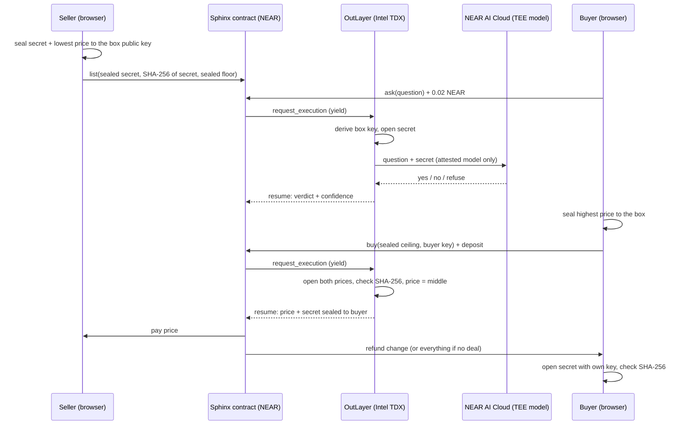

# Sphinx

**Buy secrets you can trust before you see them.**

Sphinx is a market for sealed information on NEAR. A seller locks a secret (a security finding, on-chain research, a dataset, a fix) inside a sealed box that nobody can open, not the buyer, not the operator, not us. Buyers ask the box yes-or-no questions, answered by a private AI model running in secure hardware. When a buyer wants it, both sides name a hidden price; if the prices overlap, the deal settles at the middle in one NEAR transaction and the secret is re-sealed to the buyer's own key. If anything fails, the buyer is refunded in full.

- **Contract (NEAR mainnet):** [`7c3bcf93…cee9681`](https://nearblocks.io/address/7c3bcf93a61a597e5d07547926a3e06e0d4f6d99b12323523234faa53cee9681)
- **Sealed box (OutLayer mainnet project):** `7c3bcf93a61a597e5d07547926a3e06e0d4f6d99b12323523234faa53cee9681/sphinx`
- **Tracks:** Privacy & Private AI, Agent Economy, AI Security & Defense, Open Innovation

## The problem

Information is hard to sell. If the seller shows it to prove it is real, the buyer no longer needs to pay. If the seller hides it, the buyer cannot trust it. Security researchers, analysts and data sellers either give their work away to prove it, or get ignored. Sphinx lets a buyer check what a secret contains, through narrow questions, without anyone ever seeing it, and then swaps it for payment fairly.

## How it works



1. **Seal it.** The seller's browser seals the secret and the seller's lowest price to the box's public key (libsodium sealed box, X25519 + XSalsa20-Poly1305) and commits the secret's SHA-256 on-chain. The contract only ever stores ciphertext. ([`web/src/seal.ts`](web/src/seal.ts), [`contract/src/lib.rs`](contract/src/lib.rs) `list`)
2. **Ask it.** Each question pauses the contract with NEAR's yield/resume, and OutLayer runs the sealed box inside Intel TDX. The box opens the secret, asks an attested NEAR AI Cloud model, and returns only `yes`, `no` or `refused` with a confidence. Five questions per account. ([`enclave/src/main.rs`](enclave/src/main.rs) `ask`, [`contract/src/lib.rs`](contract/src/lib.rs) `ask` / `on_answer`)
3. **Price it secretly.** The buyer seals the most they would pay. The box opens both sealed prices; if they overlap, the price is the middle. Neither side ever learns the other's number. ([`enclave/src/lib.rs`](enclave/src/lib.rs) `settle_price`)
4. **Swap it fairly.** In the same transaction the box re-seals the secret to the buyer's key and the contract pays the seller and refunds the buyer's change. Any failure refunds the buyer in full and reopens the listing. ([`contract/src/lib.rs`](contract/src/lib.rs) `buy` / `on_settled`)

## NEAR technology used (and where)

| Technology | How Sphinx uses it | Code |
|---|---|---|
| **OutLayer** (TEE execution, Intel TDX) | Runs the sealed box: `request_execution` from the contract, result delivered back through yield/resume | `contract/src/lib.rs` `run_box` |
| **OutLayer encryption keys** | The box's X25519 private key is `mac("sphinx-box", …)` of an encryption key bound to this project and to the Sphinx contract as caller; it never exists outside the TEE | `enclave/src/main.rs` `box_secret_key`, `enclave/manifest.json` |
| **OutLayer author secrets + access rules** | The NEAR AI key is an encrypted OutLayer secret, readable only by this exact build of the box and only for calls that come through the Sphinx contract | `enclave/manifest.json` `author_secrets` |
| **OutLayer network allowlist** | The box may only reach `cloud-api.near.ai` | `enclave/manifest.json` `capabilities.network` |
| **NEAR AI Cloud** (private inference in TEEs) | Answers questions; the box refuses any model that does not publish a TEE attestation, so a secret never reaches a third-party API | `enclave/src/lib.rs` `ATTESTED_MODELS`, `choose_model` |
| **NEAR yield/resume** | Every question and every sale is one logical transaction: the contract pauses while the box runs | `contract/src/lib.rs` `on_answer`, `on_settled` |
| **NEAR smart contract (Rust, near-sdk 5)** | Listings, question limits, sale lock, escrow, pay-on-confirmation, refunds | `contract/src/lib.rs` |
| **NEAR wallets** (Wallet Selector: Meteor, HOT, Intear, MyNearWallet) | Sign in and sign `list`, `ask`, `buy` | `web/src/near.ts` |

## Proof: real mainnet run

Full flow on mainnet against listing #0 (seller and buyer are two accounts of the same owner). Script: [`scripts/e2e.mjs`](scripts/e2e.mjs), results: [`scripts/proof-mainnet.json`](scripts/proof-mainnet.json).

| Step | Result | Transaction |
|---|---|---|
| Contract publishes the box key (contract → OutLayer → contract) | key `zzV8vOdQ…JRY=` in 11.5 s | [`6s8ycWMU…`](https://nearblocks.io/txns/6s8ycWMU46FS5mHBueKxq94LJ6mzkcCHN87TSjaw8Dri) |
| "Does this describe a bug that can take another user's deposited funds?" | **yes**, 100% | [`FK2aEi5Q…`](https://nearblocks.io/txns/FK2aEi5QH8KcnspjHgyg2RzyKx5nPt8BRVfs5PjpQH4i) |
| "Is the affected contract an NFT marketplace?" | **no**, 99% | [`EcDmM7Mu…`](https://nearblocks.io/txns/EcDmM7MuActadTsBjzkx7doLgSzrJ6MfYhmMNiDnjk5a) |
| "What is the first word of the finding?" | **refused** | [`4swZJPo1…`](https://nearblocks.io/txns/4swZJPo1Tzb3QLWxBYzCMpN3BuDjxPXqcLqgHHPfkERP) |
| A buy while the box could not answer | full refund, listing reopened | [`8QTTmNeM…`](https://nearblocks.io/txns/8QTTmNeMkfnsNqkEWVUnEXEXYV7aoXWZyBtqaaApN8f3) |
| Sealed offer: buyer max 0.09 NEAR vs seller min 0.05 NEAR | **sold at 0.07 NEAR** (the middle), change refunded | [`3pJx41e6…`](https://nearblocks.io/txns/3pJx41e6VhJ77dzf1m2njBdHowdGZZMzzgbyRQoC1ucF) |
| Buyer opens the secret with their own key | SHA-256 matches the listed fingerprint | `scripts/proof-mainnet.json` `"match": true` |

Measured on mainnet: a question round trip takes 11 to 21 s (most of it block time and the worker queue; the box itself runs in 1 to 6 s). A box run costs about 0.0012 NEAR; the rest of each 0.01 NEAR run fee is refunded by OutLayer.

## How to Test

### Quick test (5 minutes, on the live site)

You need a NEAR **mainnet** wallet (Meteor, HOT, Intear or MyNearWallet) with about **0.5 NEAR**. Most of it is only reserved for gas and comes straight back; a question really costs about 0.011 NEAR.

1. Open the live app (link at the top) → you see the market with listing #0, "First-depositor inflation bug in an ERC-4626 vault", marked **Sold**, and its three answered questions.
2. Click **Verify** → you see the box's public key, read live from the contract, and how each guarantee is enforced.
3. Click **Sell a secret**, sign in, type a title, at least 20 characters of secret and a lowest price like `0.05`, then **Seal and list** → your wallet asks you to approve `list`; after it confirms you land on your new listing, showing the fingerprint and "Lowest price: Sealed".
4. Sign in with a **different** account and open that listing. Ask "Does it contain more than ten words?" → the answer shows "the box is thinking…", then within about 30 seconds turns into **YES** or **NO** with a confidence.
5. Ask "What is the first word of the secret?" → it comes back **REFUSED**.
6. Under **Make a sealed offer**, click **Download a backup of your unlock key**, then enter a maximum above the seller's price (for example `0.09`) and **Seal offer** → the listing shows "comparing the two hidden prices", then **Sold** at the middle price.
7. Click **Open with my key** → the secret appears, with "Fingerprint matches the seller's commitment".

### Full test (run everything yourself)

Prerequisites: Git, Docker (or Rust 1.84 and 1.86 with `wasm32-wasip2`), Node.js 22+.

```bash
git clone https://github.com/Jennivarl/sphinx.git
cd sphinx
```

1. **Contract unit tests** (24 tests: listing rules, five-question limit, sale lock, pay only on a confirmed deal, never more than the deposit, full refund on failure):
   ```bash
   cd contract && cargo +1.86 test
   ```
   Expected: `test result: ok. 24 passed`.
2. **Sealed box unit tests** (13 tests: middle price, no overlap, deposit cap, overflow, leak-proof verdict parsing, fishing questions, attested models only):
   ```bash
   cd ../enclave && cargo +1.84 test --lib
   ```
   Expected: `test result: ok. 13 passed`.
3. **Build the sealed box** exactly as deployed (Rust 1.84 keeps its WASI imports at 0.2.2, which OutLayer's wasmtime 36 workers load):
   ```bash
   cargo +1.84 build --release --target wasm32-wasip2
   sha256sum target/wasm32-wasip2/release/sphinx-enclave.wasm
   ```
   Expected: `52945867f822fc628a49bc24fa0e618c4abfcdc61cb34f2e750976c6351aea5e`, the version the deployed project and the AI-key access rule are pinned to.
4. **Run the website locally:**
   ```bash
   cd ../web && npm ci && npm run dev
   ```
   Expected: open the printed `http://localhost:5173` and see the same market as the live site, read from mainnet.
5. **Replay the end-to-end proof** with your own accounts (costs real NEAR, about 0.1 NEAR moved between your two accounts plus about 0.05 NEAR of fees): copy `.env.example` to `.env`, set `MAINNET_ACCOUNT_ID` and `MAINNET_PRIVATE_KEY` for an account that already runs your own deployment, then:
   ```bash
   cd ../scripts && npm ci && node e2e.mjs mainnet
   ```
   Expected: three answered questions (yes / no / refused), `Sold at 0.07 NEAR`, and `opened secret matches the listed fingerprint: true`.

To deploy your own instance: build both parts as above, publish the box with the OutLayer CLI (`outlayer upload`, `outlayer deploy sphinx <url>`), store your NEAR AI key with `outlayer secrets set` bound to the project, then run `scripts/deploy-contract.mjs` and `scripts/refresh-box-key.mjs`.

## Security model and honest limits

- **What is trusted:** Intel TDX on OutLayer's workers and NEAR AI Cloud's TEE models. If those enclaves were broken, a secret could be read.
- **What leaks:** each question reveals one answer (yes / no / refused plus a confidence), never text. Five questions per account cap what one buyer learns; many accounts could ask more, and every question is public on-chain.
- **The AI can be wrong.** Answers carry a confidence. The fingerprint guarantees the buyer gets exactly what was listed, not that the AI judged it correctly.
- **The buyer's deposit is public.** The true maximum inside it stays sealed, but the deposit is an upper bound.
- **The unlock key lives in the buyer's browser.** Download the backup before buying; without it a purchased secret cannot be opened again.
- **Developer mode:** the contract account still holds its full-access key, so its owner could deploy new code. The owner has no method to move funds or read secrets, but an upgrade could add one. Before Sphinx holds real value, upgrade rights move to a Sputnik DAO with a 7-day timelock and reproducible, verified builds. The AI-key secret is already pinned to one exact build of the box.

## Business

Free during the hackathon. The model: a small fee on each settled sale (taken in the same settlement transaction), plus paid question bundles for buyers who need more than five questions per listing.

## Repository layout

| Path | What it is |
|---|---|
| `contract/` | NEAR smart contract (Rust, near-sdk 5) and its unit tests |
| `enclave/` | The sealed box: a `wasm32-wasip2` program OutLayer runs inside Intel TDX, with unit tests for its pure logic |
| `web/` | The website (Vite, React, TypeScript) |
| `scripts/` | Account setup, deploy, box key refresh, the end-to-end proof and a transaction reader |

## Libraries

near-sdk, crypto_box (RustCrypto), sha2, serde, base64, wit-bindgen, wasi-http-client, near-api-js, @near-wallet-selector, libsodium-wrappers, React, Vite.

## License

MIT
